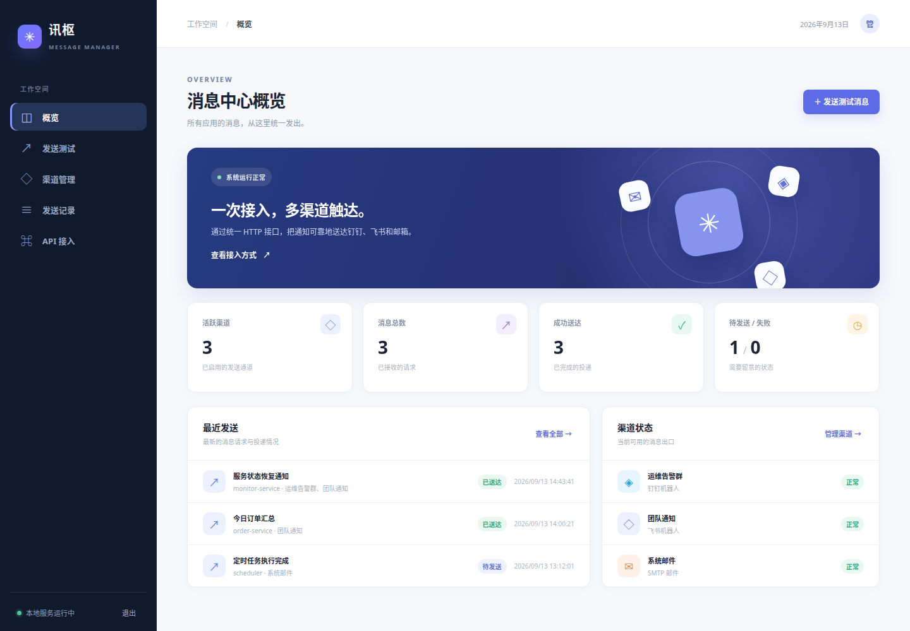
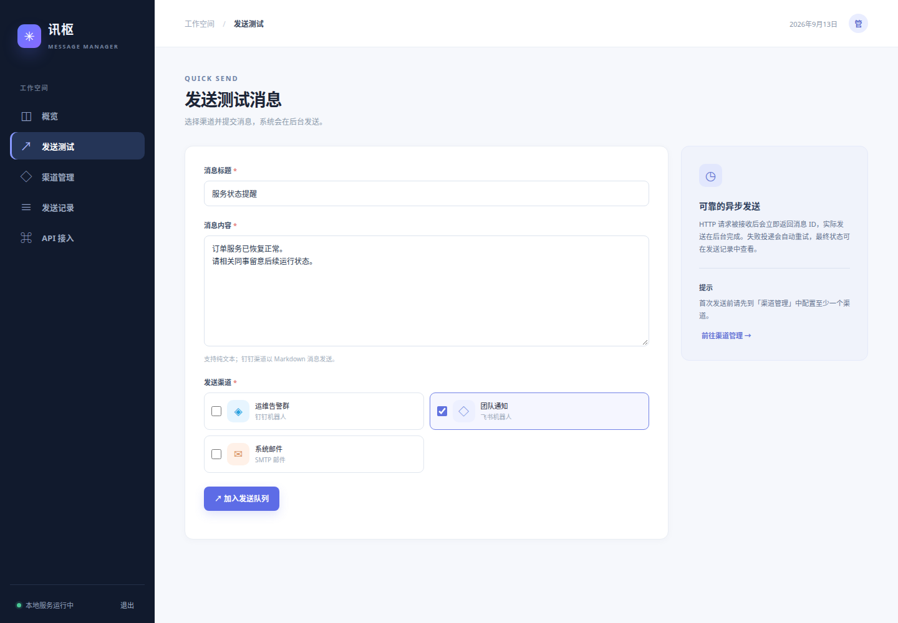
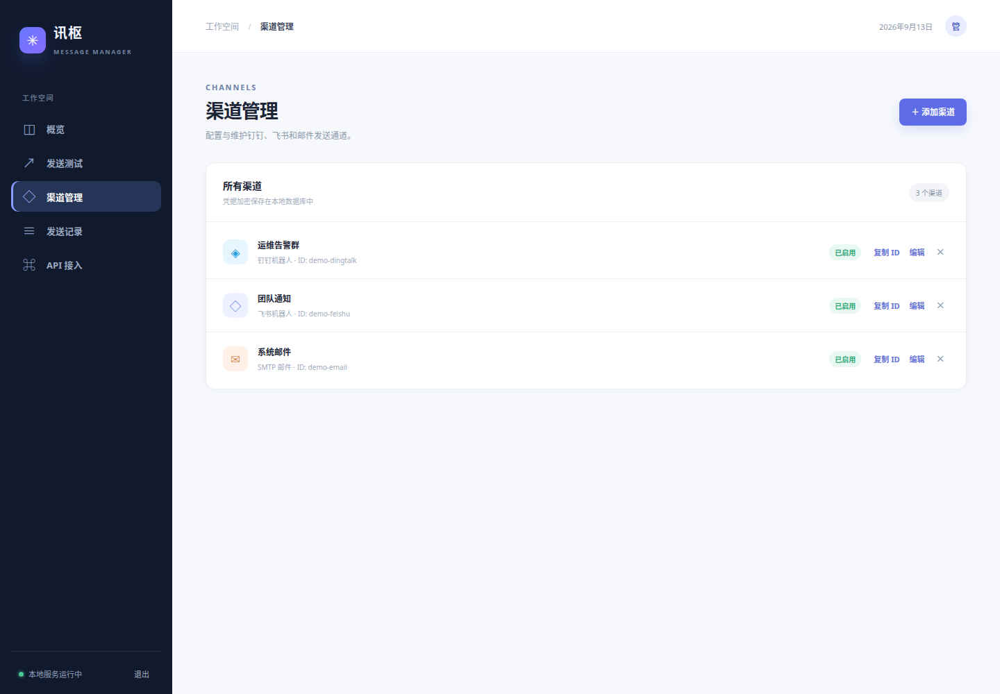
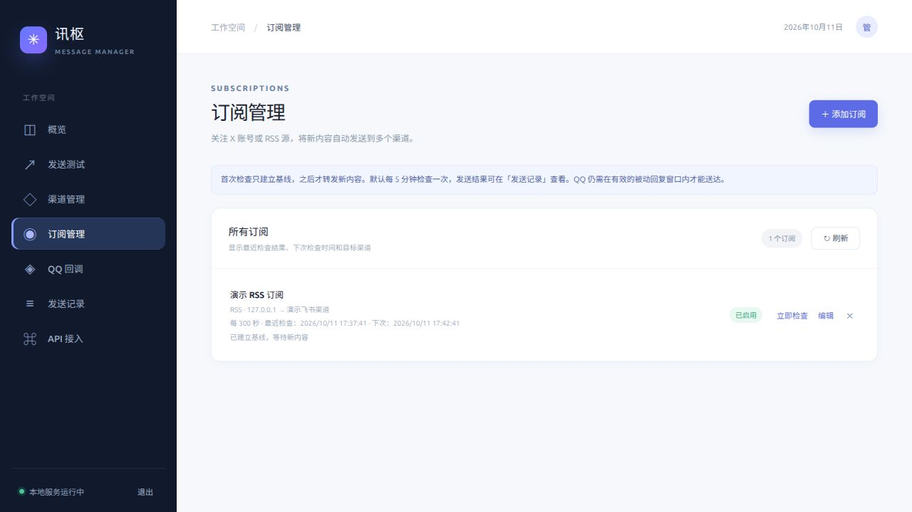
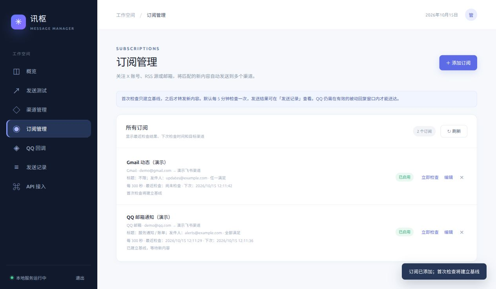
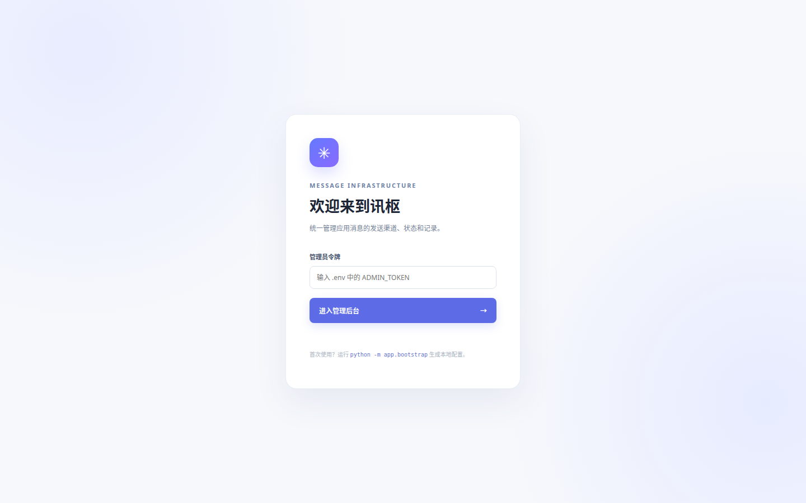

# 讯枢 · 消息发送管理

一个供多个应用共用的本地消息发送服务。应用通过 HTTP 提交消息，或订阅 X 账号、RSS/Atom 源、QQ 邮箱/Gmail，服务将消息持久化到 SQLite，再异步投递到钉钉机器人、飞书机器人、QQ 机器人（群聊或私聊）或 SMTP 邮箱。管理网页可配置渠道和订阅、测试发送、查看记录并手动重试失败投递。

## 界面预览

以下截图取自当前部署版本的页面。管理后台使用演示数据展示界面，不包含实际渠道、消息或凭据。

**消息中心概览**：查看发送统计、最近消息和渠道状态。



**发送测试**：填写消息并选择钉钉、飞书或邮件渠道。



**渠道管理**：统一维护各应用共享的发送出口。



**订阅管理**：配置 X / RSS 来源、多渠道转发和检查间隔。以下使用隔离测试数据。



**邮箱订阅**：按标题和发件人筛选 QQ 邮箱 / Gmail 的新邮件。以下使用隔离测试数据。



<details>
<summary>查看登录页面</summary>



</details>

## 本机启动

需要 Python 3.11+。在项目目录运行：

```bash
python3 -m pip install --target .deps -r requirements.txt
PYTHONPATH=.deps python3 -m app.bootstrap
PYTHONPATH=.deps python3 -m app
```

访问 `http://127.0.0.1:8000`。首次登录使用 `.env` 中的 `ADMIN_TOKEN`。如果 8000 端口已被占用，修改 `.env` 的 `PORT`，再启动服务。`.env` 和 `data/` 默认不加入版本控制。

也可以运行 `docker compose up --build -d`。先执行初始化命令生成 `.env`；Docker Compose 仅在本机 `.env` 指定的端口开放服务。

查看容器日志可运行 `docker compose logs -f message-manager`。应用和 HTTP 访问日志使用北京时间（UTC+08:00）的完整时间戳；提交、投递成功和失败都会记录消息或投递 ID，Webhook 凭据不会写入日志。管理后台的「发送测试」会等待投递结果并显示失败原因，完整历史保留在「发送记录」。

当前主机已将容器接入统一 Nginx 网关，统一监听 80/443 和备用的 1080/1443；项目容器仅将 `.env` 中的端口映射到宿主机回环地址，供同机应用调用。推荐使用 `https://message-sender.nas.haiqingd.top/` 访问管理后台，备用 HTTPS 端口为 1443；此入口使用有效的域名证书，站点配置位于 `/home/haiqingd/services/nginx-gateway/sites/message-sender.conf`。原入口 `message-manager.nas.haiqingd.top` 仍可访问，但其 HTTPS 使用临时自签名证书，浏览器会提示不受信任。公网 80 端口被拦；1080 是明文 HTTP，不要在不可信网络中通过该入口提交管理员令牌或 API Key。本机应用可继续使用 `127.0.0.1` 入口。

## 配置渠道

登录后在「渠道管理」添加渠道：

- **钉钉**：填入自定义机器人 Webhook URL，可选填加签密钥。消息以 Markdown 格式发送。
- **飞书**：填入自定义机器人 Webhook URL，可选填签名密钥。消息以文本格式发送。
- **QQ**：填入 QQ 开放平台机器人的 AppID 和 AppSecret；目标 OpenID 可以留空——留空时该渠道仅作为「机器人身份」，用于回调验签，并向自动创建的渠道提供凭据，不能直接发送。填了 OpenID 的渠道可直接发送：群聊走 `/v2/groups/{group_openid}/messages`，私聊走 `/v2/users/{openid}/messages`。目标 OpenID 来自机器人收到的事件（群消息事件中的 `group_openid`、私聊事件中的 `user_openid`），不是 QQ 号或群号。**注意：QQ 平台自 2025 年 4 月起关闭了机器人主动推送消息的能力**，本服务发送 QQ 消息时会自动转为「被动回复」：使用回调记录里该群/用户最近一条消息的 `msg_id`（60 分钟窗口内有效，每条消息最多回复 4 次）。因此发送前需要有人在 QQ 里 @ 过机器人（私聊则为给机器人发过消息）；窗口过期或次数用完时投递会失败并提示重新 @ 机器人。无人值守的告警推送建议使用钉钉/飞书渠道。
- **邮件**：填入 SMTP 主机、端口、安全方式、发件人；如服务器要求认证，再填用户名与密码。可设置默认收件人，也可在每次发送时指定。

机器人创建与安全设置可参考[钉钉开放平台](https://open.dingtalk.com/document/orgapp/custom-robot-access)、[飞书官方 Webhook 指南](https://www.feishu.cn/content/7271149634339422210)和[QQ 机器人官方文档](https://bot.q.qq.com/wiki/develop/api-v2/)。

### QQ 回调与插槽路由

本服务内置 QQ 开放平台的事件回调接口。回调签名密钥按官方算法由机器人 AppSecret 派生（AppSecret 重复至 32 字节作为 Ed25519 种子），凭据直接取自渠道配置，不需要在开放平台上传任何公钥，也不需要额外的 `.env` 项：

1. 在「渠道管理」新建一个 QQ 渠道，只填 AppID 和 AppSecret（目标 OpenID 留空），它就是回调使用的机器人身份。
2. 在 QQ 开放平台的回调配置中填写 `https://message-sender.nas.haiqingd.top/api/qq/callback/<机器人AppID>`，使用当前已经开放的标准 443 端口。QQ 开放平台只接受 80/443/8080/8443 端口，因此本机备用的 1443 端口仍可访问管理后台和消息 API，但不能用于 QQ 回调配置。平台发起的 URL 校验由服务自动应答。
3. 订阅事件（群 @ 消息 `GROUP_AT_MESSAGE_CREATE`、单聊消息 `C2C_MESSAGE_CREATE` 等）后，每个回调请求都会记录在管理页「QQ 回调」的事件记录里（兜底插槽），展开可查看原始事件与处理结果。

收到的事件按「路由规则」分发给插槽处理，规则在「QQ 回调」页添加和管理。每条规则包含：匹配条件（事件类型、聊天类型、目标 OpenID 精确匹配）和处理插槽，规则按顺序匹配、命中即执行：

- **自动创建渠道（本应用）**：从事件里的 OpenID 创建可发送的 QQ 渠道并继承机器人凭据。系统预置了一条名为「兜底：自动创建渠道」的通配规则，排在所有自定义规则之后，因此开箱即用，也可以停用或删除。
- **转发到外部插槽（Webhook）**：把事件原始 JSON POST 到任意外部服务（带 `X-QQ-Appid` / `X-QQ-Event` 头），让其他应用处理 QQ 消息；目标需在数秒内返回 2xx。
- **仅记录（兜底）**：只保留事件记录，不做任何处理；所有未命中规则的事件也走这条路。

插槽处理失败不会向 QQ 返回错误（避免平台重试造成重复副作用），失败原因记录在事件详情中。注意沙箱环境与正式环境的 OpenID 不通用，主动消息有平台频率限制。

### 组队游戏插槽

内置的互动插槽，在路由规则中选择「组队游戏（本应用）」并匹配群 @ 消息即可启用。群里 @ 机器人发送：

- **「组队」「斗」「有无」**等关键词（如「晚上有无斗地主的」「组队开黑」）：创建当日组队邀请，机器人回复报名卡片，附一排**指令按钮**：`✅ 我参加`、`20点`、`21点`、`22点`、`❌ 退出`、`📋 查询组队`。点击按钮等价于以自己的身份 @ 机器人发送对应指令，无需手打字。
- **「参加 21点」**（也识别 `加入/报名/上号/+1`）：报名并登记预计上号时间；可附昵称如「参加 21点 我是小明」，否则显示匿名 ID。
- **「查询组队」**（也识别 `谁组队/名单`）：回复当前报名名单和每个人的预计上号时间。
- **「退出」**（也识别 `不参加/取消`）：取消报名。

组队数据按「群 × 自然日」存放在本地数据库，次日自动开新局。未命中任何关键词的 @ 消息会穿透到下一条路由规则（如兜底的自动建渠道）。所有回复都是对触发消息的被动回复，符合平台的推送限制。**群聊的按钮只能挂在 Markdown 模板消息底部**（平台不支持纯按钮消息，也会丢弃挂在纯文本消息上的键盘）：未配置模板时卡片以纯文本发出、不带按钮；在 QQ 开放平台「开发设置 → 消息配置」创建含参数 `{{content}}` 的 Markdown 模板，并把模板 ID 填到路由规则的 `markdown_template_id` 配置后，卡片以 Markdown 外观发出并附按钮（`我参加`/`20点`/`21点`/`22点`/`退出`/`查询组队`），按钮权限设为所有人可见。在路由配置中设置 `{"buttons": false}` 可强制关闭按钮。

Webhook URL、签名密钥、QQ AppSecret、路由中的转发地址和 SMTP 密码使用 `.env` 中的 `ENCRYPTION_KEY` 加密后保存在数据库中，管理接口只返回是否已配置，不返回明文。请妥善备份 `.env` 和 `data/messages.db`；丢失加密密钥后无法读取原有渠道凭据。

## 订阅 X 账号、RSS 与邮箱

先配置至少一个发送渠道，再进入「订阅管理」添加订阅：

- **X 官方 API**：填写 `@账号名`、账号主页 URL 或纯账号名，以及 X 开发者平台的 Bearer Token。默认只订阅原创推文，可勾选回复、转帖。账号名会解析为用户 ID 并缓存，之后使用 `start_time` / `end_time` 查询本轮时间窗口，并分页补齐窗口内的新内容。X API 需要读取权限和可用额度，当前按用量计费，详情见 [X 官方计费文档](https://docs.x.com/x-api/getting-started/pricing)与[用户推文接口](https://docs.x.com/x-api/users/get-posts)。
- **RSS / Atom**：填写可用的 Feed URL，支持普通网站和第三方转换的 X RSS。X 没有可直接填写账号就使用的官方 RSS；RSSHub 等服务需要自行配置并验证可用性，本项目不内置公共转换服务或 X 抓取登录凭据。

每个订阅可选择多个目标渠道；邮件可配置该订阅的收件人，留空使用渠道默认收件人。默认每 300 秒检查一次，可设置为 60–86400 秒。内容以文本和原文链接转发，图片、视频不会作为附件上传。

首次成功检查仅建立时间基线，不发送已有内容；X 初次只读取最近 5 条以减少消耗。之后只处理满足 **上次成功检查时间 < 内容时间 ≤ 本次检查开始时间** 的内容。本次检查开始之后新增的内容留到下一轮；抓取或入队失败不推进成功时间，下一轮继续覆盖未成功的区间。后续新内容进入现有投递队列，在「发送记录」查看各渠道的送达、失败和重试。RSS 使用条目 ID／链接去重，并支持 ETag、Last-Modified 条件请求；遇到晚于本轮截止时间的条目时不保存条件缓存，以便下一轮再次读取。去重记录、成功时间与本轮消息入队在同一数据库事务提交。HTTP 429 会按上游限流信息延后检查。

「立即检查」会抓取并将新内容加入真实发送队列，首次使用仍只建立基线。可以编辑、停用或删除订阅；修改来源或 X 回复／转帖筛选会重新建立基线，修改目标渠道或凭据则保留进度。删除订阅保留已有发送记录。Bearer Token 和 Feed URL 加密存储，管理接口不回显明文，编辑时留空保留原值。

时间判定：X 使用推文 `created_at`；RSS/Atom 优先使用发布时间，无发布时间时采用更新时间，无有效时间的条目不转发；邮箱使用服务器 `INTERNALDATE` 接收时间。时间早于窗口的历史内容，即使出现了新 ID，也不会转发。页面分别显示最近尝试时间和窗口起点（上次成功检查时间）。升级前已有的订阅以原有最近检查时间作为新策略的起点。

订阅属于定时轮询，延迟取决于检查间隔、上游更新及排队。停用期间不检查，重新启用后继续读取可获取的新内容；长时间停机可能超出 RSS 保留窗口或 X 时间线读取范围；源服务延迟展示、而内容时间已经早于成功时间起点的条目，也会被严格时间窗口跳过。QQ 渠道仍受被动回复窗口限制，无人值守订阅推送可使用钉钉、飞书或邮件。

管理 API 使用管理员 Bearer Token：`GET/POST /api/admin/subscriptions`、`PUT/DELETE /api/admin/subscriptions/{id}`、`POST /api/admin/subscriptions/{id}/check`。例如：

```json
{
  "name": "作者动态",
  "kind": "x",
  "config": {"username": "example", "bearer_token": "填入 X Bearer Token", "include_replies": false, "include_reposts": false},
  "destinations": [{"channel_id": "替换为渠道 ID"}],
  "poll_interval": 300,
  "enabled": true
}
```

RSS 则使用 `"kind": "rss"` 和 `"config": {"feed_url": "https://example.com/feed.xml"}`。完整字段见 `/docs`。

### QQ 邮箱 / Gmail 订阅

在「订阅管理」选择「邮箱（QQ / Gmail）」，选择服务商、填写完整邮箱地址及凭据，再设置标题关键词或发件人过滤条件。服务使用固定的 IMAP SSL/TLS 入口：QQ 为 `imap.qq.com:993`，Gmail 为 `imap.gmail.com:993`，只读检查 `INBOX` 收件箱，不改变已读状态，也不下载或转发附件。

- **QQ 邮箱**：在 QQ 邮箱设置中开启 IMAP/SMTP 服务，生成并填写**授权码**。这里使用的不是 QQ 登录密码，见 [QQ 官方说明](https://service.mail.qq.com/detail/0/339)。
- **Gmail**：开启 Google 账号两步验证，创建并填写**应用专用密码**。普通登录密码不能用于本服务；受组织管理、启用高级保护等账号可能无法创建应用专用密码。当前不提供 Google OAuth 登录，见 [Google 应用专用密码说明](https://support.google.com/accounts/answer/185833?hl=zh-Hans)。部署主机需要能够连接 Gmail 的 IMAP 服务。
- **标题包含**：每行一个关键词，任意关键词包含匹配，忽略大小写；支持中文及邮件编码后的标题。
- **发件人匹配**：每行一个完整邮箱地址或发件人名称关键词。含 `@` 的条件精确匹配发件人邮箱，其他条件按显示名称包含匹配，忽略大小写。匹配的是邮件 `From` 字段，不代表经过身份验证的发件人。
- **条件组合**：默认标题或发件人任一类命中即转发，也可选择全部已填写的类别都命中。每类内部均为任一项命中；空白类别不参与匹配。至少填写一类条件。

首次成功检查仅保存检查开始时间，不转发已有邮件。之后先通过 IMAP 日期条件缩小范围，再按 `INTERNALDATE` 精确筛选上次成功检查到本次开始之间的邮件；不以邮件 `Date` 头或新 UID 判定新增内容。只有时间窗口内、标题与发件人规则匹配的邮件才会读取正文；优先纯文本，只有 HTML 时转换为文本。元数据按每批 100 封读取，完整处理本轮窗口后才提交成功时间，避免跨批次漏信；任何一批失败都会保留原窗口起点。正文过长会截取并标注。成功时间与消息入队在同一事务保存，重启后继续去重。

修改邮箱过滤条件时保留成功时间，仅对下次时间窗口内的新邮件生效，不重新筛选窗口之前的历史邮件。修改服务商或邮箱账号会重新建立时间基线。邮箱 UIDVALIDITY 改变时仍按接收时间筛选，不因 UID 重新分配而把窗口外历史邮件大量转发。凭据加密保存且不回显，编辑时留空保留原值。

管理 API 示例：

```json
{
  "name": "邮箱服务通知",
  "kind": "imap",
  "config": {
    "provider": "qq",
    "username": "example@qq.com",
    "password": "填入授权码",
    "subject_keywords": ["告警", "服务通知"],
    "senders": ["alerts@example.com", "通知服务"],
    "match_mode": "any"
  },
  "destinations": [{"channel_id": "替换为渠道 ID"}],
  "poll_interval": 300,
  "enabled": true
}
```

Gmail 使用 `"provider": "gmail"`，`password` 为应用专用密码；`match_mode` 为 `"all"` 时要求全部已填写类别满足。

## HTTP 接口

先从渠道管理复制渠道 ID，调用：

```bash
curl -X POST http://127.0.0.1:8000/api/v1/messages \
  -H 'Content-Type: application/json' \
  -H 'X-API-Key: <.env 中的 MESSAGE_API_KEY>' \
  -d '{
    "source": "order-service",
    "title": "订单服务状态提醒",
    "body": "订单服务已恢复正常。",
    "destinations": [{"channel_id": "替换为渠道 ID"}],
    "idempotency_key": "recovered-001"
  }'
```

接口返回 HTTP `202`、消息 ID 和各投递初始状态。`source` 标识调用应用，默认为 `default`；同一 `source` 内重复使用 `idempotency_key` 会返回原消息，避免重复投递。邮箱收件人可在目标中传入 `"recipients": ["user@example.com"]`；未传时使用渠道默认收件人。一个请求可包含多个不同的渠道。

使用相同的 `X-API-Key` 请求 `GET /api/v1/messages/{id}` 查看投递结果。状态包括 `pending`、`sending`、`sent` 和 `failed`。投递最多自动尝试 3 次，失败间隔逐步增加；最终失败可在管理网页手动重试。完整接口说明见 `/docs`。

管理接口使用 `Authorization: Bearer <ADMIN_TOKEN>`。应用调用方只需要 `MESSAGE_API_KEY`，不要把 `ADMIN_TOKEN` 分发给业务应用或放入浏览器前端代码。

## 运行边界

默认只监听 `127.0.0.1`，适合同机多个应用调用。跨机器使用时，请通过 HTTPS 反向代理暴露服务，并限制访问来源。当前是单进程、轻量队列方案；部署时保持一个服务进程，避免多进程重复管理发送任务。服务重启会恢复尚未完成的投递，但外部服务已接受而本地尚未记录成功的极端情况仍可能重复发送；业务侧应使用幂等键处理重复提交。

## 测试

```bash
PYTHONPATH=.deps:. python3 -m pytest -q
```
